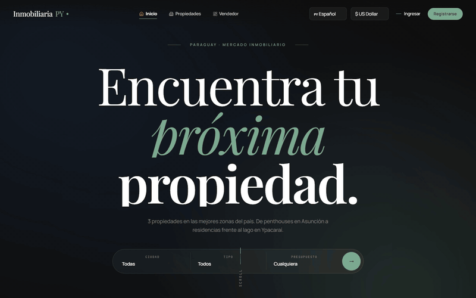
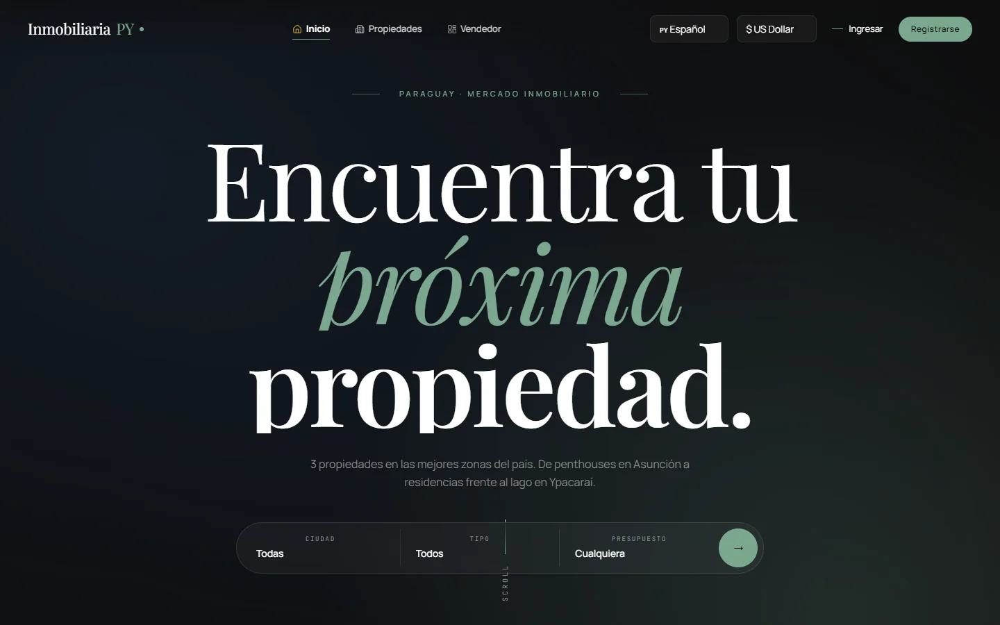
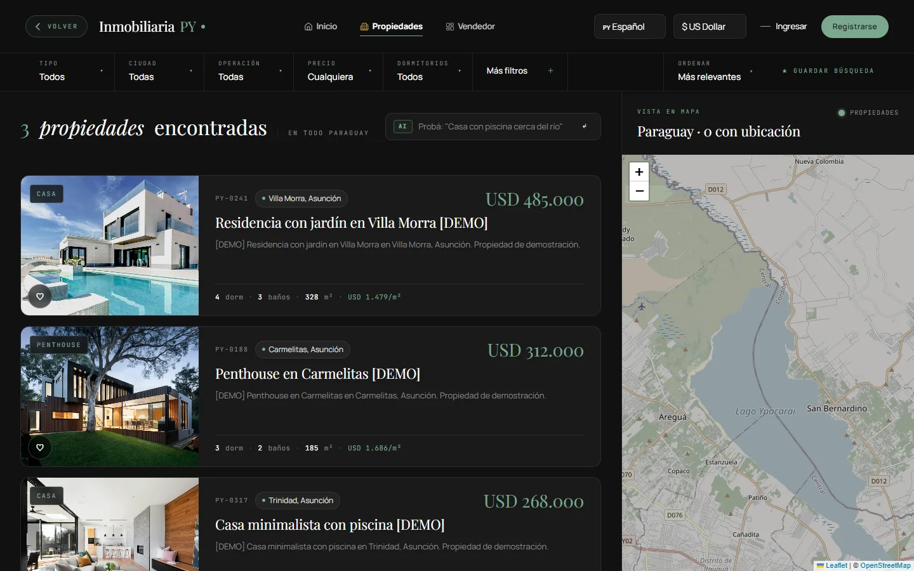
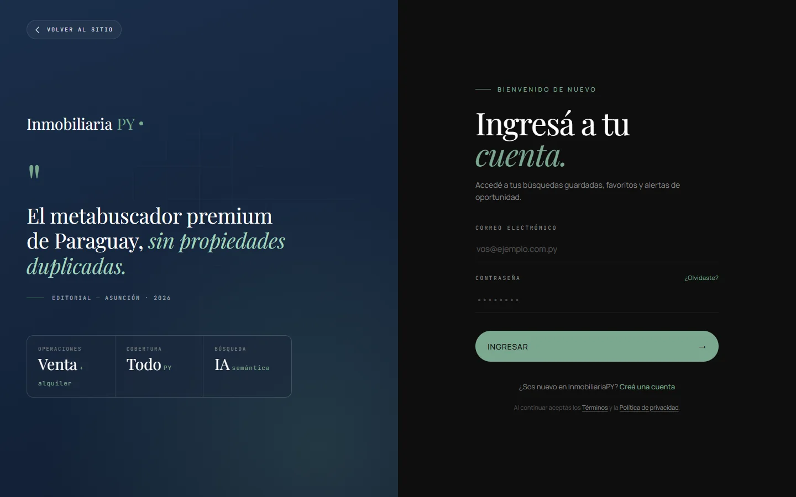
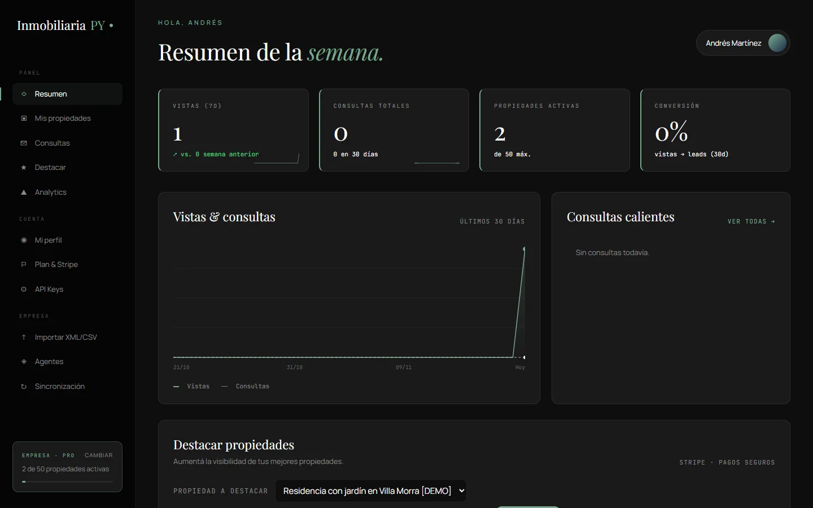
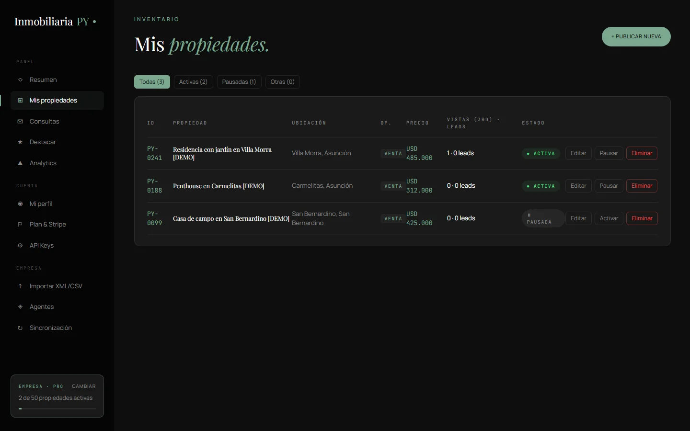
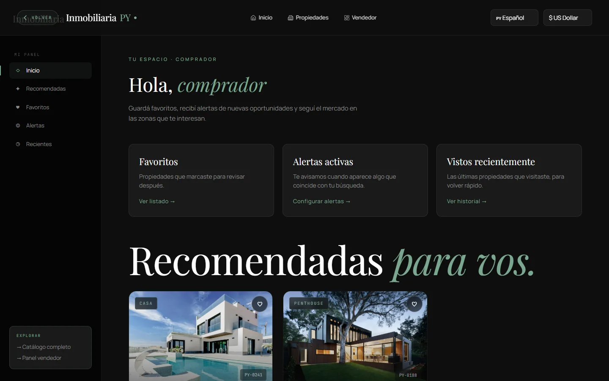
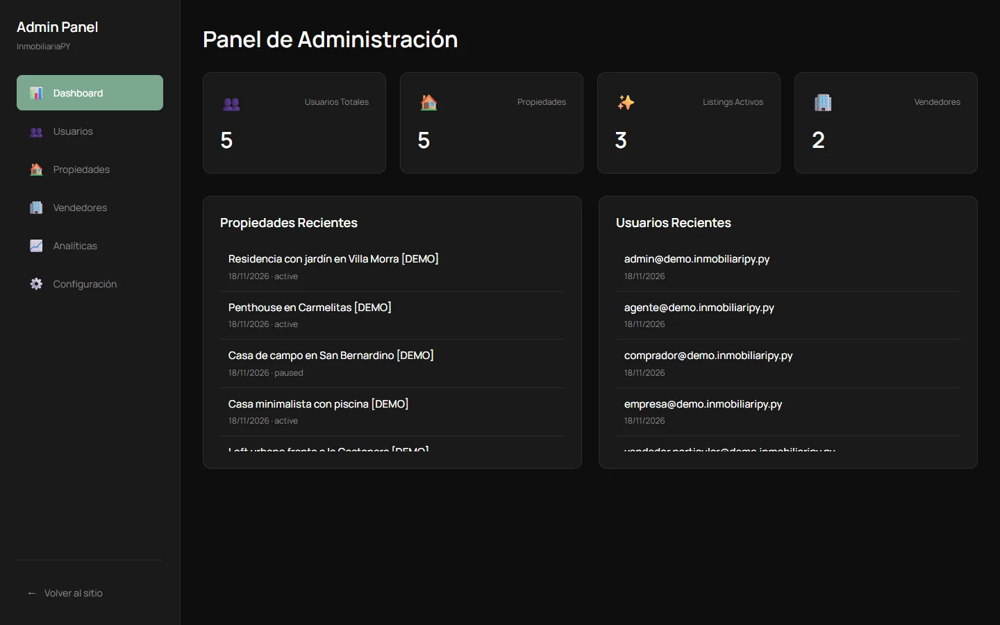

<div align="center">

# InmobiliariaPY

Plataforma inmobiliaria para Paraguay: publicación y búsqueda de propiedades, paneles para compradores, vendedores y administradores, pagos con Stripe, búsqueda semántica con IA y una API pública.




</div>

---

##  Sobre el proyecto

InmobiliariaPY es un **proyecto de desarrollo y aprendizaje**. Lo construí para practicar una aplicación full stack completa:
- **Next.js con App Router:** Server Components y Server Actions.
- **Supabase:** PostgreSQL con Row Level Security (RLS), Auth y migraciones versionadas.
- **Integraciones externas:** pagos con Stripe, embeddings de OpenAI y notificaciones push.
- **Seguridad:** proceso de auditoría y corrección.

Sigue **en desarrollo**: no está publicado en producción, y algunas funciones necesitan claves de servicios externos para funcionar (ver [Correr en local](#-correr-en-local)).

##  Demo

El GIF de arriba y las capturas de abajo son de la app corriendo **en local**, con la base de datos de demostración: 5 cuentas de prueba y 5 inmuebles ficticios marcados con `[DEMO]`. La demo se crea sola al recrear la base con `supabase db reset`, como se explica en [`docs/demo-local.md`](docs/demo-local.md).

##  Funcionalidades

**Sitio público**
- Portada con buscador por ciudad, tipo y presupuesto.
- **Listado de propiedades:**
  - filtros por tipo, ciudad, operación, precio y dormitorios;
  - ordenamiento;
  - **mapa interactivo** (Leaflet + OpenStreetMap).
- **Ficha de cada propiedad:** galería, características, ubicación y contacto con el vendedor.
- **Búsqueda semántica con IA:** embeddings de OpenAI y `pgvector`.
- **Idioma y moneda:** español/inglés y PYG/USD.

**Paneles por rol** (rutas protegidas por un proxy de Next.js según el rol)

| Rol | Funciones |
|---|---|
| **Comprador** | Favoritos, alertas por búsquedas guardadas, propiedades vistas recientemente, recomendaciones |
| **Vendedor particular** | Sus propiedades (alta, edición, estados), consultas (leads), analíticas y destacados |
| **Vendedor empresa** | Lo mismo que el particular, más agentes, importación XML/CSV, sincronización de feeds y API keys |
| **Administrador** | Métricas generales y gestión de usuarios, propiedades, vendedores y configuración |

**Backend e integraciones**
- **Stripe:** planes de suscripción y destacados (boosts) pagos, con webhook firmado.
- **API pública v1** (`/api/v1/properties`): autenticación con API keys, documentación OpenAPI en `/api-docs` y límite diario de requests por clave.
- **Notificaciones push:** service worker y VAPID.
- **Emails transaccionales** con Resend.
- **Tareas programadas** con Vercel Cron: vencimiento de destacados, alertas, sincronización de feeds y reinicio de cuotas de API.

##  Capturas

| Inicio | Listado con mapa |
|---|---|
|  |  |
| **Ficha de la propiedad** | **Inicio de sesión** |
|  |  |
| **Panel del vendedor** | **Propiedades del vendedor** |
|  |  |
| **Panel del comprador** | **Panel de administración** |
|  |  |

##  Arquitectura

```
                 ┌────────────────────────────────────────────┐
  Navegador ───► │  Next.js 16 (App Router)                    │
                 │  · Server Components y Server Actions        │
                 │  · proxy.ts: protección de rutas por rol    │
                 │  · 26 rutas de API (Stripe, IA, cron, v1...) │
                 └──────┬──────────────┬──────────────┬────────┘
                        │              │              │
              ┌─────────▼──────┐ ┌─────▼──────┐ ┌─────▼────────────────┐
              │ Supabase       │ │ Stripe     │ │ OpenAI · Resend ·    │
              │ PostgreSQL+RLS │ │ checkout + │ │ Web Push (VAPID)     │
              │ Auth · Storage │ │ webhooks   │ │                      │
              │ pgvector       │ └────────────┘ └──────────────────────┘
              └────────────────┘
```

- **Datos:** el esquema vive en `supabase/migrations/` (16 migraciones). La seguridad se resuelve con políticas **RLS** por rol, y el modelo de propiedades usa la vista `properties_full`.
- **Autenticación:** Supabase Auth con cookies SSR (`@supabase/ssr`). El rol de cada usuario se guarda en `profiles`.
- **Pagos:** el webhook de Stripe valida la firma y actualiza en la base los planes de los vendedores (`seller_profiles`) y los destacados (`property_boosts`, `listings`).

##  Tecnologías

| Capa | Tecnologías |
|---|---|
| **Framework** | Next.js 16 (App Router), React 19, TypeScript 5 |
| **Estilos y animación** | Tailwind CSS 3, Framer Motion, GSAP |
| **Datos y auth** | Supabase (PostgreSQL, RLS, Auth, Storage, pgvector) |
| **Formularios y estado** | React Hook Form, Zod, Zustand |
| **Pagos** | Stripe |
| **IA** | OpenAI (embeddings para búsqueda semántica) |
| **Mapas** | Leaflet, React Leaflet, OpenStreetMap |
| **Notificaciones** | Web Push (VAPID), Resend |
| **Importación** | xml2js (XML), CSV |
| **Deploy previsto** | Vercel (+ Vercel Cron) |

##  Estructura

```
Inmobiliaria_py/
├── src/
│   ├── app/
│   │   ├── (seller)/vendedor/   # Panel del vendedor
│   │   ├── comprador/           # Panel del comprador
│   │   ├── admin/               # Panel de administración
│   │   ├── propiedades/         # Listado y ficha pública
│   │   ├── auth/                # Login, registro y recuperación
│   │   └── api/                 # Stripe, IA, importación, cron, push, API v1
│   ├── components/              # UI por rol y componentes compartidos
│   ├── lib/                     # Clientes de Supabase, Stripe, OpenAI, i18n, stores
│   └── proxy.ts                 # Protección de rutas por rol
├── supabase/
│   ├── migrations/              # Esquema, RLS, funciones y storage
│   ├── seed.sql                 # Datos base
│   └── seeds/demo.sql           # Demo local (5 cuentas y 5 inmuebles)
├── public/                      # Íconos, manifest y service worker
└── docs/                        # Arquitectura, auditoría, demo local y capturas
```

##  Correr en local

**Requisitos:**
- Node.js 20 o superior.
- [Supabase CLI](https://supabase.com/docs/guides/local-development/cli/getting-started).
- Docker Desktop, que Supabase usa para levantar la base de datos local.

```bash
git clone https://github.com/vecs0/Inmobiliaria_py.git
cd Inmobiliaria_py
npm install
supabase start          # levanta Postgres, Auth y Storage en Docker
supabase db reset       # aplica migraciones + seed + demo local
```

Copiá `.env.example` a `.env.local` y completá las variables de Supabase con los valores que muestra `supabase status`:
- `NEXT_PUBLIC_SUPABASE_URL`
- `NEXT_PUBLIC_SUPABASE_ANON_KEY`
- `SUPABASE_SERVICE_ROLE_KEY`

Después:

```bash
npm run dev             # http://localhost:3000
```

**Cuentas de demo:** las 5 cuentas (comprador, vendedor particular, vendedor empresa, agente y admin) y su contraseña de laboratorio están en [`docs/demo-local.md`](docs/demo-local.md). Solo existen en tu base local.

**Qué necesita claves externas:** los pagos (Stripe), la búsqueda semántica (OpenAI), los emails (Resend) y las notificaciones push (VAPID). Sin esas claves, esas funciones no se ejecutan; el resto de la app (listado, ficha, mapa, login y paneles por rol) funciona solo con Supabase local.

> **Windows:** si `supabase start` falla con `ports are not available` en el rango 54321–54329, es porque Windows o Hyper-V reservan esos puertos. Podés verlo con `netsh interface ipv4 show excludedportrange protocol=tcp` y cambiar los puertos en `supabase/config.toml`.

##  Seguridad

El proyecto pasó por una auditoría previa a producción y por un plan de corrección:
- **Protección SSRF** en la importación de feeds: resolución de DNS fijada y plazo total para la descarga.
- **Redirecciones seguras** después del login (`safeRedirect`).
- **Webhook de Stripe** con verificación de firma, y **endpoints de cron** protegidos con `CRON_SECRET`.
- **Políticas RLS** por rol en todas las tablas, y la `service_role` usada solo en el servidor.
- **Seed de demo con una guardia** que impide sembrar datos fuera del entorno local.

Detalle en [`docs/auditoria-produccion.md`](docs/auditoria-produccion.md) y [`docs/plan-remediacion.md`](docs/plan-remediacion.md).

##  Documentación

| Documento | Contenido |
|---|---|
| [`docs/arquitectura.md`](docs/arquitectura.md) | Manual técnico y de arquitectura |
| [`docs/documentacion-proyecto.md`](docs/documentacion-proyecto.md) | Bitácora de funcionalidades implementadas |
| [`docs/demo-local.md`](docs/demo-local.md) | Cómo funciona y se recrea la demo local |
| [`docs/evaluacion-proyecto.md`](docs/evaluacion-proyecto.md) | Evaluación técnica previa a la corrección |
| [`docs/auditoria-produccion.md`](docs/auditoria-produccion.md) | Auditoría previa a producción |
| [`docs/plan-remediacion.md`](docs/plan-remediacion.md) | Plan de corrección aplicado |
| [`supabase/MIGRACIONES.md`](supabase/MIGRACIONES.md) | Orden y contenido de las migraciones |

##  Versiones

| Versión | Fecha | Cambios |
|---|---|---|
| **V3** (actual) | Mayo – Noviembre 2026 | Next.js 16 + Supabase + Stripe + IA, auditoría y corrección de seguridad, demo local reproducible |

##  Autor

<table>
  <tr>
    <td></td>
    <td>
      <strong>Victor Emmanuel Cabrera Sosa</strong><br>
      <a href="https://github.com/vecs0">vecs0 · github.com/vecs0</a>
    </td>
  </tr>
</table>

##  Licencia

Distribuido bajo la licencia **MIT**. Consultá el archivo [LICENSE](LICENSE) para el texto completo.

| Permisos | Condiciones | Limitaciones |
|---|---|---|
| ✔ Uso comercial<br>✔ Modificación<br>✔ Distribución<br>✔ Uso privado | Incluir el aviso de copyright y la licencia | ✖ Sin garantía<br>✖ Sin responsabilidad |

**Contenido de terceros:** Next.js, Supabase, Stripe, Leaflet y las demás dependencias se distribuyen bajo sus propias licencias. Las fotos de los inmuebles de demostración vienen de [Unsplash](https://unsplash.com) (licencia de Unsplash). Los datos de mapas son de © colaboradores de OpenStreetMap.

© 2026 Victor Emmanuel Cabrera Sosa
