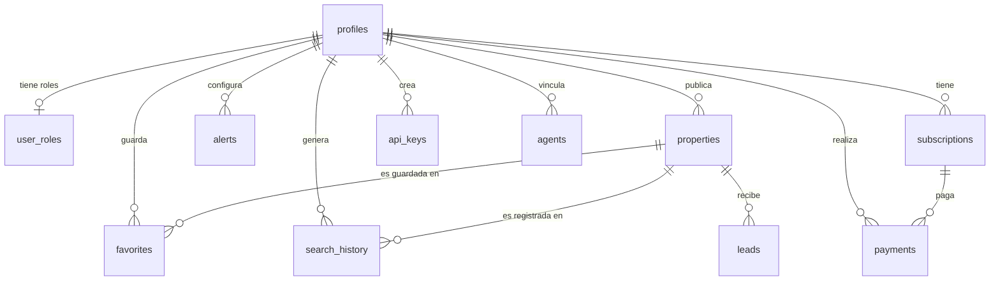

# InmobiliariaPY — Documentación Técnica y Manual de Arquitectura Completo
---

Este documento constituye la **documentación técnica definitiva y manual de arquitectura** de **InmobiliariaPY V3**. Su propósito es detallar de extremo a extremo todo el proceso de desarrollo, la estructura real del repositorio, la funcionalidad específica de cada archivo, las tecnologías aplicadas y el flujo lógico del sistema, consolidando todo el conocimiento técnico junto con la **Guía Completa de Implementación**.

---

## 📊 1. Introducción y Visión General del Proyecto

**InmobiliariaPY V3** es una plataforma inmobiliaria moderna de alto rendimiento orientada a Paraguay, diseñada bajo una arquitectura modular que combina la robustez de **Next.js 16 (App Router)** en el frontend y **Supabase** como plataforma de backend (BaaS).

El objetivo principal de la versión 3 ha sido **unificar el diseño visual premium y la experiencia interactiva pulida de la V2** (que incluye efectos de textura de grano, micro-animaciones con GSAP/Framer Motion, glassmorphism y cursores personalizados) con la **arquitectura técnica segura y escalable de la V3** (que incorpora roles múltiples, seguridad estricta a nivel de base de datos RLS, procesamiento automatizado, pasarelas de pago y búsqueda semántica con Inteligencia Artificial).

---

## 🛠️ 2. Pila Tecnológica (Detalle Técnico Completo)

La arquitectura de la aplicación está cimentada sobre tecnologías modernas seleccionadas para garantizar máxima velocidad, escalabilidad y una experiencia de usuario sobresaliente:

```mermaid
graph TD
    A[Next.js 16 Frontend App Router] -->|Autenticación y SSR| B[@supabase/ssr]
    A -->|Consultas y Mutaciones| C[Supabase client-side / Server Actions]
    A -->|Efectos Visuales Premium| D[GSAP / Framer Motion]
    A -->|Formularios y Validación| E[React Hook Form / Zod]
    A -->|Estado Global Temas/Filtros| F[Zustand]
    A -->|Mapas Interactivos| G[Leaflet / React Leaflet]
    B -->|Base de Datos y RLS| H[Supabase Database PostgreSQL]
    H -->|Búsqueda Semántica IA| I[pgvector & OpenAI Embeddings]
    H -->|Notificaciones y Cron Jobs| J[Supabase Edge Functions]
    A -->|Pagos y Suscripciones| K[Stripe Billing & Checkout]
    J -->|Invitación Agentes| L[Resend Email API]
```

### 1. Core Framework: Next.js 16 (App Router)
*   **App Router**: Organización de rutas intuitiva mediante carpetas, facilitando layouts anidados y optimización automática.
*   **React Server Components (RSC)**: Carga de datos directamente en el servidor para reducir el JavaScript enviado al cliente, mejorando los tiempos de carga y el SEO.
*   **Server Actions**: Mutaciones seguras ejecutadas en el servidor sin necesidad de declarar endpoints API explícitos.
*   **Middleware a nivel Edge**: Verificación de sesión y roles en milisegundos directamente en los servidores Edge antes de que la página comience a renderizarse.

### 2. Backend-as-a-Service: Supabase
*   **PostgreSQL**: Base de datos relacional robusta con soporte nativo para JSONB (amenities, fotos), transacciones y triggers complejos.
*   **Row Level Security (RLS)**: Las reglas de acceso están escritas directamente en la base de datos. Ningún cliente web puede leer o modificar datos ajenos, blindando la seguridad del sistema.
*   **Supabase Auth**: Autenticación integrada mediante JWT con soporte para tokens de acceso y flujos de recuperación automáticos.
*   **Supabase Storage**: Buckets públicos y privados para fotos de propiedades y avatars.
*   **Supabase Edge Functions**: Funciones Serverless en TypeScript para tareas asíncronas y cron jobs (`xml-sync`, `send-alert-notifications`, `invite-agent`).
*   **pgvector**: Extensión de PostgreSQL para almacenar vectores y realizar búsquedas de similitud semántica.

### 3. Animaciones e Interfaz Premium: GSAP & Framer Motion
*   **GSAP (GreenSock Animation Platform)**: Control ultrapreciso para animaciones complejas de rendimiento extremo (como el cursor dinámico, efectos de scroll y parallax).
*   **Framer Motion**: Transiciones de página suaves, menús desplegables fluidos y modales interactivos con física real.
*   **Estilos y Glassmorphism**: Combinación de clases de Tailwind CSS con un archivo de estilos curados (`v2-styles.css`) para aplicar desenfoques de fondo (backdrop-blur), sombras suaves y colores armónicos (eliminando el uso de colores planos genéricos).

### 4. Pasarela de Pagos: Stripe
*   **Stripe Checkout**: Formularios de pago ultra-seguros hospedados por Stripe para suscripciones recurrentes de planes particulares y empresas.
*   **Stripe Elements / Payment Intents**: Para pagos únicos relacionados con el "boost" (destacar) de propiedades por períodos de 7, 15 o 30 días.
*   **Webhooks**: Procesamiento de eventos en tiempo real (pago exitoso, fallo de factura, cancelación) para sincronizar inmediatamente el estado en la base de datos de Supabase.

### 5. Otras Integraciones
*   **React Leaflet / Leaflet**: Integración de mapas interactivos utilizando OpenStreetMap sin costos asociados de licencias.
*   **Resend API**: Envío de correos transaccionales ultrarrápido y limpio (por ejemplo, para invitaciones a agentes y alertas de nuevos leads).
*   **Zustand**: Gestor de estado ligero para sincronizar filtros de búsqueda y estados de la UI global.
*   **React Hook Form & Zod**: Manejo de validación tipada y estructurada para formularios altamente complejos como el formulario multi-paso de propiedad.
*   **xml2js**: Parser de archivos XML para la ingesta y sincronización masiva de inventarios desde portales de empresas externas.

---

## 📂 3. Estructura Completa del Proyecto

El proyecto está unificado en un **repositorio de aplicación Next.js único con estructura modular**, lo que optimiza las dependencias, facilita el despliegue rápido y mantiene una base de código altamente cohesionada y fácil de mantener.

### 🧭 Árbol de Directorios Físico y Real del Proyecto

```text
inmobiliaria-py/
├── .env.example                       # Plantilla de variables de entorno compartidas
├── .env.local                         # Variables locales de desarrollo (Stripe, Supabase, etc.)
├── eslint.config.mjs                  # Configuración del linter
├── middleware.ts                      # Middleware de protección de rutas basado en roles
├── next-env.d.ts                      # Tipos globales de Next.js
├── next.config.mjs                    # Configuración de Next.js
├── package-lock.json                  # Lockfile de dependencias npm
├── package.json                       # Dependencias y scripts del proyecto (Next.js 16)
├── postcss.config.mjs                 # Configuración de PostCSS
├── tailwind.config.ts                 # Configuración de Tailwind CSS (Aesthetic V2)
├── tsconfig.json                      # Configuración de TypeScript
├── docs/                              # Documentación técnica (esta guía, auditoría, demo local)
│
├── legacy-ui/                         # Artefactos e interfaz legada (V2 original)
│
├── scripts/                           # Scripts de soporte técnico
│   └── verify-supabase.mjs            # Verifica tablas/vistas de Supabase
│
├── supabase/                          # Backend de la base de datos Supabase
│   ├── config.toml                    # Configuración del CLI de Supabase
│   ├── schema.sql                     # Estructura del esquema base
│   ├── seed.sql                       # Agentes de referencia del seed local
│   ├── seeds/demo.sql                 # Demo local (corre tras seed.sql, con guardia)
│   ├── verify-tables.sql              # Script SQL de verificación de integridad
│   ├── MIGRACIONES.md                 # Guía para aplicar las migraciones
│   └── migrations/                    # Archivos SQL cronológicos de migraciones oficiales
│       ├── 20260513120000_property_views.sql
│       ├── 20260513130000_saved_searches.sql
│       ├── 20260513140000_security_fixes.sql
│       ├── 20260513150000_security_fixes_v2.sql
│       ├── 20260513160000_fix_decrement_trigger.sql
│       ├── 20260513180000_property_boosts.sql
│       ├── 20260513190000_pgvector_semantic.sql
│       ├── 20260514170000_performance_fixes.sql
│       ├── 20260514171000_fix_expire_property_boosts_search_path.sql
│       └── 20260514200000_api_keys.sql
│
└── src/                               # Código fuente de la aplicación Next.js
    ├── app/                           # Enrutador App Router
    │   ├── globals.css                # Estilos base globales
    │   ├── v2-styles.css              # Hoja de estilos del diseño V2 (premium glassmorphism)
    │   ├── layout.tsx                 # Layout raíz con providers globales
    │   ├── page.tsx                   # Página HOME (renderiza LandingClient con estética premium)
    │   │
    │   ├── (seller)/                  # Grupo de rutas para vendedores
    │   │   └── vendedor/              # Rutas /vendedor/* protegidas por middleware
    │   │       ├── layout.tsx         # Sidebar adaptable del vendedor (Particular vs Empresa)
    │   │       ├── page.tsx           # Dashboard del vendedor (renderiza DashboardClient)
    │   │       ├── ActiveLink.tsx     # Enlace activo con estilos visuales V2
    │   │       ├── analytics/         # Módulo de analíticas avanzadas
    │   │       ├── api-keys/          # Gestión de API Keys corporativas
    │   │       ├── destacados/        # Gestión de boost de propiedades (DestacadosV2Client)
    │   │       ├── leads/             # Consultas en tiempo real
    │   │       ├── propiedades/       # Gestión de propiedades (SellerPropertiesClient)
    │   │       └── suscripcion/       # Administración del plan e historial de pagos
    │   │
    │   ├── api/                       # Rutas de API backend locales
    │   │   ├── ai/                    # Servicios de IA y recomendaciones
    │   │   ├── contact/               # Envío de consultas de leads
    │   │   ├── cron/                  # Tareas automáticas del servidor
    │   │   ├── healthcheck/           # Monitoreo de estado de Supabase/Stripe
    │   │   ├── import/                # Procesamiento de importaciones XML/CSV
    │   │   ├── search/                # Catálogo de búsqueda filtrada de propiedades
    │   │   ├── track-view/            # Registro de visitas para analíticas
    │   │   ├── upload/                # Subida de imágenes a Supabase Storage
    │   │   ├── stripe/                # Endpoints de pagos Stripe
    │   │   │   ├── boost-checkout/    # Checkout de pagos únicos de destaque
    │   │   │   ├── checkout/          # Checkout de suscripciones
    │   │   │   └── webhook/           # Capturador de eventos de Stripe
    │   │   └── v1/                    # API pública versionada para integraciones
    │   │       ├── openapi.json/      # Documentación OpenAPI Swagger
    │   │       └── properties/        # Endpoint público CRUD de propiedades
    │   │
    │   ├── auth/                      # Rutas de Autenticación
    │   │   ├── login/                 # Página de Login (renderiza LegacyAuthClient)
    │   │   └── register/              # Página de Registro (renderiza LegacyAuthClient)
    │   │
    │   ├── comprador/                 # Rutas /comprador/* protegidas por middleware
    │   │   ├── page.tsx               # Dashboard básico del comprador (BuyerDashboardClient)
    │   │   └── layout.tsx             # Sidebar del panel de comprador
    │   │
    │   └── propiedades/               # Rutas de Catálogo de Propiedades
    │       ├── page.tsx               # Buscador dinámico público (renderiza ListingClient)
    │       └── [id]/                  # Detalle de propiedad pública (renderiza DetailClient)
    │
    ├── components/                    # Componentes React de UI
    │   ├── NavV2.tsx                  # Navbar adaptable premium con menú dropdown
    │   ├── PublicChrome.tsx           # Contenedor visual público premium
    │   │
    │   ├── auth/                      # Formularios y pasos de registro e inicio de sesión
    │   │   ├── AccountTypeCard.tsx    # Tarjeta de selección visual de tipo de cuenta
    │   │   ├── AccountTypeStep.tsx    # Paso de selección de rol (Comprador/Particular/Empresa)
    │   │   ├── CompanyDataStep.tsx    # Paso de datos corporativos (RUC, razón social)
    │   │   ├── CredentialsStep.tsx    # Paso de usuario y contraseña
    │   │   ├── PersonalDataStep.tsx   # Paso de datos personales y teléfono
    │   │   ├── GoldInput.tsx          # Entrada de datos estilizada con marco premium dorado
    │   │   └── PasswordInput.tsx      # Selector de contraseña con visibilidad toggle
    │   │
    │   ├── seller/                    # Componentes para el panel de ventas
    │   │   ├── DarkDashboardClient.tsx# Dashboard del vendedor con tema oscuro premium
    │   │   └── SellerSidebar.tsx      # Barra de navegación lateral del vendedor
    │   │
    │   ├── ui/                        # Componentes básicos de interfaz estilizados (Base UI / Shadcn)
    │   │   ├── CustomCursor.tsx       # Cursor inteligente dinámico basado en GSAP
    │   │   ├── FloatingRoleButton.tsx # Botón flotante para alternar entre rol comprador/vendedor
    │   │   ├── GrainOverlay.tsx       # Overlay sutil de textura de papel/grano en movimiento
    │   │   ├── LanguageSwitcher.tsx   # Selector rápido de idiomas de Paraguay (ES/GN/PT)
    │   │   ├── button.tsx, card.tsx, input.tsx, etc. # Componentes base reutilisables
    │   │
    │   └── v2/                        # Componentes migrados con la estética V2 Premium
    │       ├── LandingClient.tsx      # UI de la página principal (Home)
    │       ├── ListingClient.tsx      # UI del catálogo y filtros
    │       ├── DetailClient.tsx       # UI de la ficha detallada de propiedad con mapa y contacto
    │       ├── LegacyAuthClient.tsx   # UI integrada de inicio de sesión y registro
    │       ├── DashboardClient.tsx    # UI del panel del vendedor
    │       ├── BuyerDashboardClient.tsx # UI del panel del comprador
    │       ├── DestacadosV2Client.tsx # UI para la compra de destaques premium
    │       ├── SellerPropertiesClient.tsx # UI de la lista de propiedades cargadas por el vendedor
    │       ├── SellerShell.tsx        # Contenedor visual del panel de vendedor
    │       ├── dashboard-helpers.tsx  # Funciones auxiliares para formato de métricas
    │       └── dashboard-types.ts     # Tipos de datos para el dashboard de ventas
    │
    ├── hooks/                         # Hooks de React
    │   └── use-lead-realtime.ts       # Suscripción WebSocket en tiempo real a la tabla `leads`
    │
    └── lib/                           # Funciones utilitarias y configuraciones
        ├── constants.ts               # Estructuras de datos fijas (Zonas de Paraguay)
        ├── cors.ts                    # Cabeceras CORS para integraciones
        ├── data.ts                    # Consultas directas de datos a la base de datos Supabase
        ├── deduplication.ts           # Algoritmo de filtrado de duplicados XML/CSV
        ├── openai.ts                  # Integración de embeddings OpenAI
        ├── property-adapter.ts        # Mapea anuncios externos al esquema del portal
        ├── utils.ts                   # Funciones genéricas utilitarias
        ├── v2-data.tsx                # Mocks y configuraciones adicionales de la interfaz
        │
        ├── actions/                   # Server Actions de React
        │   ├── properties.ts          # Acciones para insertar/actualizar propiedades
        │   └── seller.ts              # Acciones para límites de plan y suscripciones
        │
        ├── api/                       # Clientes para servicios web
        │   └── validate-key.ts        # Validación de autenticación de llaves de API
        │
        ├── auth/                      # Seguridad y roles de usuarios
        │   ├── roles.ts               # Enumeraciones de roles del sistema
        │   └── role-utils.ts          # Funciones de comprobación de permisos de rol
        │
        ├── i18n/                      # Configuración de traducción
        ├── import/                    # Parseadores para archivos de datos externos
        ├── schemas/                   # Esquemas Zod
        │   └── register-schemas.ts    # Esquemas para la validación del registro multi-paso
        │
        ├── seller/                    # Lógica de planes del vendedor
        ├── seo/                       # Generadores dinámicos de metadatos SEO
        ├── store/                     # Stores globales Zustand
        │   ├── compare-store.ts       # Almacén para el comparador de propiedades
        │   └── register-store.ts      # Almacén persistente para el registro multi-paso
        │
        ├── stripe/                    # Cliente de Stripe y planes de destaques
        │   ├── config.ts              # Configuración base del SDK de Stripe
        │   └── boost-plans.ts         # Tabla de precios y duraciones de destaque
        │
        └── supabase/                  # Consultas avanzadas y base de datos
            ├── client.ts              # Cliente Supabase del lado del navegador
            ├── server.ts              # Cliente Supabase de servidor y cookies
            ├── types.ts               # Tipos TypeScript exportados
            ├── database.types.ts      # Tipos PostgreSQL generados automáticamente
            ├── analytics-actions.ts   # Métricas y estadísticas de vistas
            ├── api-key-actions.ts     # CRUD de API Keys
            ├── boost-actions.ts       # Acciones sobre destaques
            ├── healthcheck.ts         # Verificación del estado de servicios
            ├── saved-searches-actions.ts # Gestión de búsquedas guardadas y alertas
            ├── similar-actions.ts     # Similitud semántica vectorial (pgvector)
            └── favorites.ts           # Gestión de favoritos (♡)
```

---

## 🔍 4. Explicación Detallada de Archivos Críticos

### 🚪 Enrutamiento y Middleware
*   **[middleware.ts](file:///c:/Users/emman/OneDrive/Documents/Inmobiliaria_py/middleware.ts)**:
    Es el guardián de seguridad a nivel de enrutador. Utiliza `@supabase/ssr` para verificar las cookies de sesión en el Edge de manera ultrarrápida.
    *   *Propósito*: Bloquear accesos no autorizados a `/comprador/*` y `/vendedor/*`.
    *   *Flujo de redirección*: 
        - Si no hay usuario y se intenta entrar a rutas privadas, redirige a `/auth/login` guardando el parámetro `redirect` en la URL.
        - Si un vendedor logueado intenta entrar a `/comprador`, el middleware lo redirige automáticamente a `/vendedor` (y viceversa para evitar la confusión de flujos).
        - Si un usuario ya logueado intenta ir a `/auth/login` o `/auth/register`, resuelve automáticamente su perfil y lo redirige a su panel correspondiente utilizando la función `resolveHomePath`.

### 🗄️ Librería de Base de Datos y Clientes
*   **[src/lib/supabase/client.ts](file:///c:/Users/emman/OneDrive/Documents/Inmobiliaria_py/src/lib/supabase/client.ts)**:
    Inicializa el cliente de Supabase para su uso exclusivo en **Client Components** (`"use client"`). Utiliza el token anónimo público de manera segura en el navegador.
*   **[src/lib/supabase/server.ts](file:///c:/Users/emman/OneDrive/Documents/Inmobiliaria_py/src/lib/supabase/server.ts)**:
    Crea el cliente Supabase orientado a **Server Components**, **Server Actions** y **API Routes**. Maneja de forma segura las cookies de sesión del usuario de manera que la sesión persista correctamente a través de la cabecera HTTP.
*   **[src/lib/supabase/database.types.ts](file:///c:/Users/emman/OneDrive/Documents/Inmobiliaria_py/src/lib/supabase/database.types.ts)**:
    Contiene la declaración tipada en TypeScript de todo el esquema de la base de datos de Supabase. Esto garantiza autocompletado en el editor y previene errores en tiempo de compilación.

### 🎨 Componentes Visuales y de Diseño
*   **[src/components/NavV2.tsx](file:///c:/Users/emman/OneDrive/Documents/Inmobiliaria_py/src/components/NavV2.tsx)**:
    El menú de navegación superior premium de la aplicación.
    *   *Lógica*: Detecta de forma reactiva si el usuario está autenticado. Si está desconectado, muestra links limpios de búsqueda junto a los botones de "Iniciar Sesión" y el llamativo botón flotante de "Publicar Propiedad".
    *   *Menú Dinámico*: Si el usuario está autenticado, renderiza su avatar (con fallback a sus iniciales) que al hacer clic despliega un menú interactivo con glassmorphism que se adapta a su rol (Dashboard de Comprador, Dashboard de Vendedor, Configuración y Cerrar Sesión).
*   **[src/components/v2/](file:///c:/Users/emman/OneDrive/Documents/Inmobiliaria_py/src/components/v2/)**:
    Carpeta contenedora de componentes interactivos estéticos:
    *   *Cursor Personalizado*: Un cursor dinámico con GSAP que sigue el mouse con inercia y cambia de escala sobre botones o cards cliqueables.
    *   *Fondo de Textura de Grano*: Superposición visual sutil que emula papel o grano cinematográfico en movimiento para otorgar profundidad artística a los fondos oscuros.

### 🔄 Integración en Tiempo Real y Consultas
*   **[src/hooks/use-lead-realtime.ts](file:///c:/Users/emman/OneDrive/Documents/Inmobiliaria_py/src/hooks/use-lead-realtime.ts)**:
    Proporciona una conexión persistente mediante WebSockets a la base de datos utilizando los canales de **Supabase Realtime**.
    *   *Propósito*: Permite que el vendedor reciba alertas en tiempo real y vea aparecer instantáneamente consultas de potenciales compradores en su panel sin necesidad de refrescar la página.

### 💼 Lógica de Integración de Datos y Similitudes
*   **[src/lib/openai.ts](file:///c:/Users/emman/OneDrive/Documents/Inmobiliaria_py/src/lib/openai.ts)**:
    Configura el SDK de OpenAI. Su función principal es enviar textos descriptivos de propiedades para generar vectores numéricos (Embeddings) de 1536 dimensiones que luego son almacenados en la columna `embedding` para las búsquedas semánticas.
*   **[src/lib/supabase/similar-actions.ts](file:///c:/Users/emman/OneDrive/Documents/Inmobiliaria_py/src/lib/supabase/similar-actions.ts)**:
    Llama a las funciones SQL de Supabase encargadas de realizar cálculos de similitud de cosenos vectoriales (`similar_properties` y `match_properties`).
    *   *Función*: Retornar propiedades sugeridas basadas en la descripción conceptual de otra propiedad, potenciando el módulo de recomendaciones por IA para el comprador.

---

## 🔄 5. Flujos Clave del Sistema

El sistema implementa flujos dinámicos optimizados de extremo a extremo que conectan la interfaz de usuario con la persistencia en base de datos de manera limpia:

### 1. Flujo de Registro y Roles
El sistema maneja un esquema multirrol dinámico adaptado a las necesidades de Paraguay:

```text
                  ┌──────────────────────────────┐
                  │ ¿Qué desea hacer el usuario? │
                  └──────────────┬───────────────┘
                                 │
         ┌───────────────────────┼──────────────────────┐
         ▼                       ▼                      ▼
┌──────────────────┐   ┌──────────────────┐   ┌──────────────────┐
│  Quiero Buscar   │   │ Soy Particular   │   │   Soy Empresa    │
└────────┬─────────┘   └────────┬─────────┘   └────────┬─────────┘
         │                       │                       │
         ▼                       ▼                       ▼
  Rol: 'buyer'           Rol: 'seller_part'      Rol: 'seller_comp'
         │                ¿Doble rol?            (Suscripción PRO)
         │                       │                       │
         ▼            ┌──────────┴──────────┐            │
┌──────────────────┐  ▼                     ▼            ▼
│ /comprador/favs  │  SÍ: buyer_role=true   NO    ┌──────────────┐
└──────────────────┘  │                     │     │  /vendedor/  │
                      ▼                     ▼     │  dashboard   │
                 Rol dual:             Rol único: └──────────────┘
                 'seller' + 'buyer'    'seller'
```

*   **Comprador (`buyer`)**: Orientado a la búsqueda libre, guardado de favoritos (en Supabase si está logueado, en localStorage si es anónimo para posterior sincronización) y configuración de alertas automáticas.
*   **Vendedor Particular (`seller_particular`)**: Acceso al panel de publicación con límite de anuncios (por ejemplo, hasta 5 propiedades). Tiene la capacidad de activar el **"Doble Rol"** para navegar como comprador desde el mismo menú sin cerrar sesión.
*   **Vendedor Empresa (`seller_company`)**: Diseñado para inmobiliarias o desarrolladoras. Otorga características premium avanzadas (importaciones masivas, agentes ilimitados, llaves de API externas y sincronización automática).

### 2. Formulario de Publicación Multi-paso (5 Pasos)
Ubicado en `src/app/(seller)/vendedor/propiedades/nueva/page.tsx`, implementa un robusto flujo guiado y validado:
1.  **Paso 1: Información Básica**: Cards visuales para seleccionar tipo (Casa, Dpto, etc.), toggle de operación (Venta o Alquiler) y campos de texto estructurados con validación Zod.
2.  **Paso 2: Ubicación**: Selectores en cascada (Departamento ➔ Ciudad ➔ Barrio) precargados con la división política real de Paraguay. Mapa interactivo donde un clic del usuario coloca un pin y captura las coordenadas geográficas exactas (latitud y longitud).
3.  **Paso 3: Detalles**: Configuración de precios (con toggle de divisa PYG/USD), dimensiones de superficies, habitaciones, baños y checkboxes estilizados para amenities.
4.  **Paso 4: Fotos**: Zona de carga "drag & drop" que realiza la subida directa a Supabase Storage y permite organizar el orden de las imágenes (la primera foto seleccionada se marca visualmente con el badge "Portada").
5.  **Paso 5: Revisión**: Una previsualización de alta fidelidad que replica exactamente lo que verá el comprador final. Al presionar "Publicar", el anuncio se envía a cola de moderación (`pending`) o se guarda como borrador (`draft`).

### 3. Sistema de Alertas Inteligentes y Búsqueda Semántica
*   Un comprador puede programar alertas de búsqueda basadas en filtros específicos (ej: "Casas en Luque menores a 500,000,000 PYG").
*   Cuando un vendedor publica una propiedad y esta es aprobada (pasa a `active`), se dispara un trigger en la base de datos que evalúa las alertas de los compradores. Si coincide, se envía una notificación Push enriquecida a través del **Service Worker (`sw.js`)** instalado en el navegador del comprador.
*   Gracias a **pgvector**, el comprador cuenta con la pestaña `/recomendadas`, la cual analiza los últimos anuncios visitados por el usuario, obtiene sus embeddings correspondientes de OpenAI, y realiza una consulta matemática rápida de similitud para proponerle las mejores opciones disponibles de forma personalizada.

### 4. Sincronización Masiva XML/CSV
*   Las empresas pueden evitar la carga manual ingresando la URL de su propio catálogo en formato XML (estándar tipo Inmobila o similar).
*   Una **Supabase Edge Function** ejecuta un cron diario que realiza un fetch de dicha URL, analiza los elementos con `xml2js`, descarta duplicados comparando con el `external_id` (mediante `deduplication.ts`), y realiza inserciones en bloque (batch inserts) en la base de datos, actualizando precios o dándole de baja a propiedades vendidas de forma automática.

---

## 🗄️ 6. Base de Datos: Estructura de Tablas y Migraciones

La base de datos se rige por un esquema relacional estricto con políticas RLS (Row Level Security) que protegen la privacidad de los datos en todo momento:



### 📋 Tablas Principales de Supabase

#### `public.profiles` (Perfil de Usuario Extendido)
*   `id` (UUID, PK): Vinculado a `auth.users(id)`.
*   `full_name` (TEXT), `phone` (TEXT), `avatar_url` (TEXT), `description` (TEXT).
*   `buyer_role_enabled` (BOOLEAN): Estado del doble rol comprador para particulares.
*   `buyer_role_paid` (BOOLEAN): Control si el perfil del comprador requiere características premium.

#### `public.user_roles` (Esquema Multirrol de Seguridad)
*   `id` (UUID, PK).
*   `user_id` (UUID, FK): Relación con el usuario.
*   `role` (TEXT): Valores válidos `('buyer', 'seller_particular', 'seller_company', 'admin')`.
*   `active` (BOOLEAN): Permite inhabilitar roles sin borrar registros.

#### `public.properties` (Inventario Inmobiliario)
*   `id` (UUID, PK).
*   `seller_id` (UUID, FK): Creador del anuncio.
*   `title` (TEXT), `description` (TEXT), `type` (TEXT), `operation` (TEXT).
*   `price` (NUMERIC), `currency` (TEXT): Soporte PYG / USD.
*   `surface_total` (NUMERIC), `surface_built` (NUMERIC).
*   `bedrooms` (INTEGER), `bathrooms` (INTEGER), `garage` (BOOLEAN).
*   `amenities` (JSONB): Array flexible de servicios (piscina, quincho, etc.).
*   `department` (TEXT), `city` (TEXT), `neighborhood` (TEXT), `address` (TEXT), `latitude` (NUMERIC), `longitude` (NUMERIC).
*   `photos` (JSONB): Array de URLs de fotos almacenadas en Storage.
*   `status` (TEXT): Control de estados `('draft', 'pending', 'active', 'paused', 'rejected', 'expired')`.
*   `featured_until` (TIMESTAMP): Límite temporal de destaque premium.
*   `views_count` (INTEGER): Contador acumulado de visitas.
*   `embedding` (vector, 1536): Almacena el vector semántico del anuncio.

#### `public.leads` (Consultas entre Compradores y Vendedores)
*   `id` (UUID, PK).
*   `property_id` (UUID, FK): Propiedad de interés.
*   `buyer_id` (UUID, FK), `seller_id` (UUID, FK).
*   `message` (TEXT), `buyer_phone` (TEXT), `buyer_email` (TEXT).
*   `read` (BOOLEAN): Estado de lectura de la consulta.

#### `public.favorites` (Favoritos del Comprador)
*   `id` (UUID, PK).
*   `user_id` (UUID, FK), `property_id` (UUID, FK).

#### `public.search_history` (Métricas de Comportamiento e IA)
*   `id` (UUID, PK).
*   `user_id` (UUID, FK), `property_id` (UUID, FK).
*   `search_query` (JSONB): Términos y filtros aplicados por el usuario.
*   `action` (TEXT): Registro de actividad `('search', 'view', 'contact')`.

#### `public.alerts` (Alertas de Búsqueda)
*   `id` (UUID, PK).
*   `user_id` (UUID, FK), `department` (TEXT), `city` (TEXT), `property_type` (TEXT).
*   `price_min` (NUMERIC), `price_max` (NUMERIC), `currency` (TEXT).
*   `push_enabled` (BOOLEAN), `email_enabled` (BOOLEAN), `active` (BOOLEAN).

#### `public.plans` (Planes de Suscripción de Vendedores)
*   `id` (UUID, PK), `name` (TEXT), `type` (TEXT), `price_monthly` (NUMERIC).
*   `max_properties` (INTEGER), `max_photos` (INTEGER), `has_boost` (BOOLEAN), `has_api` (BOOLEAN), `has_xml` (BOOLEAN), `has_agents` (BOOLEAN).
*   `stripe_price_id` (TEXT).

#### `public.subscriptions` (Suscripciones Activas de Stripe)
*   `id` (UUID, PK), `user_id` (UUID, FK), `plan_id` (UUID, FK), `stripe_subscription_id` (TEXT), `stripe_customer_id` (TEXT).
*   `status` (TEXT): `('active', 'canceled', 'past_due', 'trialing')`.
*   `current_period_start` (TIMESTAMP), `current_period_end` (TIMESTAMP).

#### `public.payments` (Historial de Cobros)
*   `id` (UUID, PK), `user_id` (UUID, FK), `subscription_id` (UUID, FK), `stripe_payment_intent_id` (TEXT).
*   `amount` (NUMERIC), `currency` (TEXT), `status` (TEXT), `description` (TEXT).
*   `refund_requested_at` (TIMESTAMP), `refund_reason` (TEXT), `refunded_at` (TIMESTAMP).

#### `public.api_keys` & `public.agents` (Módulos Corporativos)
*   `api_keys`: Credenciales con hashes irreversibles para que empresas integren sus propios softwares de gestión con InmobiliariaPY de manera autónoma.
*   `agents`: Permite a los dueños de inmobiliarias invitar agentes bajo su jerarquía para delegar la administración y atención de consultas de anuncios específicos.

---

### 🛡️ Políticas RLS (Row Level Security) y Seguridad

La seguridad está programada para que el cliente Next.js consulte directamente la base de datos sin comprometer la integridad del sistema:

1.  **Lectura Pública Protegida**: 
    Cualquier visitante no registrado puede leer propiedades, pero única y exclusivamente si su `status` es igual a `'active'`.
2.  **Aislamiento del Vendedor**:
    Los vendedores solo tienen permisos de lectura, inserción, actualización y eliminación de propiedades si la columna `seller_id` coincide de forma exacta con su UID de sesión (`auth.uid()`).
3.  **Privacidad de Alertas y Favoritos**:
    Solo el propietario del perfil puede consultar, crear o eliminar sus propios registros de favoritos e historial de búsquedas (`user_id = auth.uid()`).
4.  **Bypass de Administrador**:
    El rol de administrador (`admin`) cuenta con políticas habilitadas mediante subconsultas en la tabla `user_roles` que le permiten leer y auditar la totalidad de las tablas y realizar moderación de contenido sin restricciones.

---

## 🚀 7. Guía de Despliegue e Infraestructura

El despliegue de InmobiliariaPY V3 se divide entre **Vercel** (para la aplicación Next.js y APIs) y **Supabase Cloud** (para base de datos, almacenamiento de archivos multimedia y Edge Functions).

### Configuración de Vercel (Sprint 2)
El proyecto incluye configuración optimizada para despliegue en Vercel mediante `vercel.json`:
- **Security Headers**: X-Content-Type-Options, X-Frame-Options, X-XSS-Protection, Referrer-Policy
- **Edge Runtime**: Configurado para regiones iad1 (US East) para baja latencia en Paraguay
- **Environment Variables**: Mapeo de variables críticas (Supabase, Stripe, OpenAI, Resend, CRON_SECRET)
- **Rewrites**: Configuración de rutas API para manejo correcto de endpoints

### Sistema de Internacionalización y Moneda (Sprint 2)
Implementación completa de soporte multi-idioma y multi-moneda:
- **Idiomas**: Español (ES) e Inglés (EN) con sistema de traducción React Context
- **Monedas**: Dólares Americanos (USD) y Guaraníes (PYG) con conversión automática
- **Tasa de cambio**: 1 USD = 7800 PYG (configurable)
- **Persistencia**: Preferencias guardadas en localStorage
- **Componente**: `<LanguageCurrencySelector />` para cambio rápido de idioma/moneda
- **Formateo**: Uso de Intl.NumberFormat para formato correcto de precios según locale

### Panel de Administración (Sprint 2)
Panel administrativo completo en `/admin/*` con:
- **Dashboard**: Métricas globales (usuarios, propiedades, vendedores, listings activos)
- **Gestión de Usuarios**: Tabla con email, nombre, fecha creación, último acceso
- **Gestión de Propiedades**: Tabla con título, precio, operación, estado, vendedor
- **Gestión de Vendedores**: Tabla con empresa, tipo, límite agentes, estado
- **Analíticas**: Gráficos de propiedades por estado, tipo de operación y mes
- **Configuración**: Ajustes generales, pagos, email, límites del sistema
- **Seguridad**: Acceso restringido a usuarios con `user_metadata.is_admin === true`

### SEO Dinámico (Sprint 2)
Generación automática de metadatos SEO para cada propiedad:
- **Title**: Formato dinámico con título, operación, ciudad y marca
- **Description**: Primeros 160 caracteres de la descripción o fallback generado
- **OpenGraph**: Imágenes OG con dimensiones estándar (1200x630), título y descripción
- **Twitter Cards**: Soporte completo para sharing en Twitter
- **Canonical URL**: URL canónica para evitar contenido duplicado
- **Fallback**: Metadatos por defecto para propiedades no encontradas

### Edge Functions Optimizadas (Sprint 2)
Conversión de endpoints críticos a Edge Runtime:
- **xml-sync**: Procesamiento de feeds XML en el edge para menor latencia
- **notify-alerts**: Envío de emails de alertas programadas via Resend API
- **invite-agent**: Sistema de invitación de agentes con email HTML template
- **Performance**: Reducción de cold start y mejor respuesta para operaciones I/O-bound

### Push Notifications con Service Worker (Sprint 3)
Sistema completo de notificaciones push en tiempo real:
- **Service Worker**: `public/sw.js` con cache básico y handlers para push notifications
- **API Endpoints**: `/api/push/subscribe` (registro de suscripción), `/api/push/send` (envío de notificaciones)
- **Hook Custom**: `use-service-worker` para registro y suscripción a push notifications
- **UI Component**: `PushNotificationToggle` para activar/desactivar notificaciones en panel de alertas
- **Integración**: notify-alerts cron job ahora envía push notifications además de emails
- **VAPID**: Configuración de Web Push Protocol con VAPID keys para seguridad
- **Fallback**: Si push falla, email sigue enviándose como fallback

### Historial Recientes con localStorage Fallback (Sprint 3)
Historial de propiedades vistas accesible sin login:
- **localStorage Fallback**: Guarda vistas en localStorage para usuarios no autenticados (máximo 20)
- **Hook Custom**: `use-recent-views` y `useTrackPropertyView` para tracking de vistas
- **Acceso Público**: `/comprador/recientes` accesible sin login
- **Indicador Visual**: Muestra "(sesión actual)" cuando usando localStorage
- **Tracking Automático**: Integrado en DetailClient para tracking automático de vistas
- **Sincronización**: Cuando usuario inicia sesión, datos de Supabase tienen prioridad
- **Deduplicación**: Elimina duplicados por property_id manteniendo vista más reciente

### 🖥️ Despliegue en Vercel

1.  **Conexión de Repositorio**: Vincular la rama principal de producción (habitualmente `main`).
2.  **Configuración de Variables de Entorno**:
    *   `NEXT_PUBLIC_SUPABASE_URL`: Endpoint de API de Supabase.
    *   `NEXT_PUBLIC_SUPABASE_ANON_KEY`: Llave pública anónima de cliente.
    *   `NEXT_PUBLIC_STRIPE_PUBLIC_KEY`: Llave pública de Stripe.
    *   `STRIPE_SECRET_KEY`: Llave privada de Stripe (Server-side).
    *   `STRIPE_WEBHOOK_SECRET`: Secreto para verificar la firma de eventos enviados por Stripe.
    *   `OPENAI_API_KEY`: API Key de OpenAI para generación de embeddings de IA.
    *   `RESEND_API_KEY`: Llave de Resend para el envío de correos automatizados.
3.  **Optimización de Cabeceras**: El archivo `vercel.json` autoinyecta cabeceras de seguridad que previenen ataques de clickjacking (`X-Frame-Options: DENY`) y deshabilitan el rastreo automático de motores de búsqueda en áreas administrativas de control (`X-Robots-Tag: noindex, nofollow`).

### 📦 Configuración y Mantenimiento de Supabase

1.  **Habilitar Webhooks de Base de Datos**: Configurar el trigger para que, ante cada nueva inserción en la tabla `properties` con estatus activo, se invoque la Edge Function `/send-alert-notifications`.
2.  **Creación de Buckets en Storage**:
    *   `property-photos`: Bucket público con políticas RLS de lectura global e inserción/actualización exclusiva para usuarios con rol de vendedor.
    *   `avatars`: Bucket público para fotos de perfiles de usuarios.
3.  **Configuración de Cron de Sincronización**: Programar la Edge Function de sincronización de feed XML (`xml-sync`) para que corra de forma recurrente mediante llamadas HTTP firmadas con una clave secreta (`CRON_SECRET`) para evitar ejecuciones externas maliciosas.

---

## 💡 8. Resumen del Proceso de Migración e Implementación

El desarrollo exitoso del proyecto se estructuró a lo largo de las siguientes fases secuenciales, logrando un balance perfecto entre velocidad y robustez:

*   **Fase Base y Entorno**: Configuración de variables de entorno locales, definición rigurosa de tipos TypeScript de la base de datos y ordenamiento de dependencias en `package.json`.
*   **Aseguramiento del Esquema de Datos**: Aplicación de la secuencia de migraciones relacionales, creación de vistas optimizadas (`properties_full`), instalación de extensiones PostgreSQL críticas (`vector`) y establecimiento de políticas RLS.
*   **Blindaje de Rutas y Sesión**: Creación de clientes Supabase adaptables (Browser y Server) e implementación del Middleware Edge para filtrar solicitudes de manera instantánea y limpia.
*   **Perfeccionamiento Estético (Fusión V2-V3)**: Integración de la hoja de estilos curados de la versión V2, inicialización de animaciones premium GSAP y cursor dinámico sobre el maquetado del catálogo e inicio.
*   **Desarrollo de Flujos de Negocio**: Construcción del formulario multi-paso de carga de propiedades con mapas interactivos de Paraguay, integración de la pasarela Stripe para boost de anuncios y automatización de alertas en tiempo real.
*   **Auditoría y Puesta a Punto**: Healthchecks interactivos para monitorear el estado de los servicios externos y optimización de SEO semántico en todas las vistas de la plataforma.

---
> [!IMPORTANT]
> **Nota de Seguridad**: Nunca expongas la variable `SUPABASE_SERVICE_ROLE_KEY` ni llaves privadas de Stripe en componentes del cliente. Utiliza siempre Server Actions o endpoints de API locales con validación de middleware para realizar tareas sensibles de administración.
